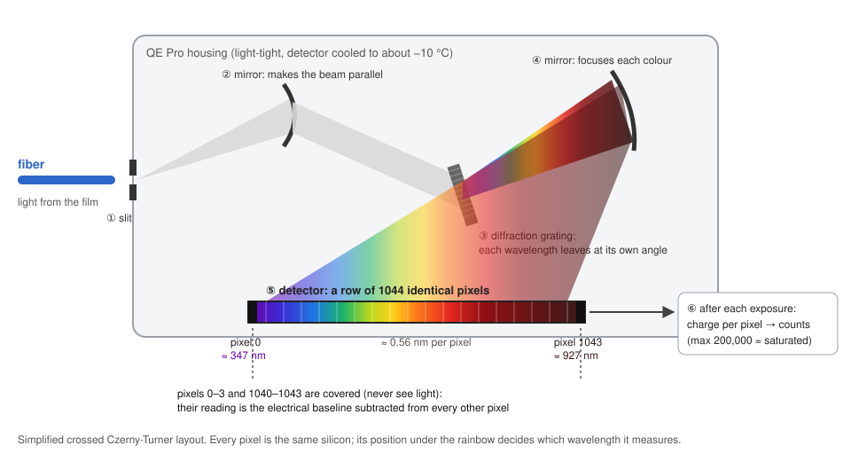
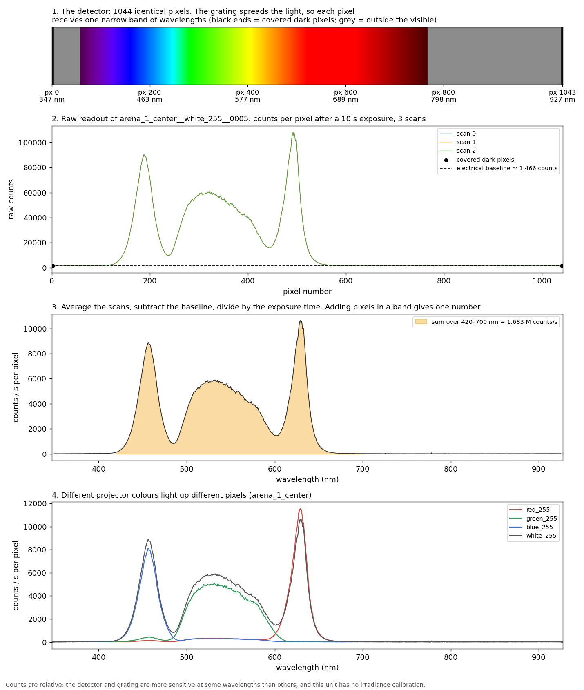

# How the spectrometer turns light into numbers

A teaching note for reading SpecSail calibration-run data. The examples come from the omnifin0 projector run of
2026-10-19/20 (Ocean Insight QE Pro QEP04819, P50 fiber, BenQ X3100i projector).

## 1. The light path



1. Light from the fiber enters through a narrow **slit**.
2. A curved mirror makes the beam parallel.
3. A **diffraction grating**, a surface ruled with very fine lines, sends each wavelength off at its own angle.
   White light leaves as a fan of colours.
4. A second mirror focuses that fan onto the detector.
5. The **detector** is a row of **1044 identical pixels**. Each sits under one narrow slice of the rainbow, so
   each measures one band of wavelengths. On this unit the row covers about **347–927 nm**, about **0.56 nm per
   pixel**. A wavelength calibration stored in the device (a few polynomial coefficients) converts pixel number
   to wavelength. That is the `wavelength_nm` column in every `spectrum.csv`.
6. During the exposure each pixel collects charge in proportion to the light landing on it. At the end the
   electronics read every pixel and convert its charge to **counts** (maximum 200,000, which is saturation). The
   detector is cooled to about −10 °C so it adds little false signal of its own over long exposures.

Pixels **0–3 and 1040–1043** are covered with metal and never see light. Their reading is the detector's
electrical baseline.

### As a movie

```bash
pixi run animate runs/<run_id> --position arena_1_center --out light_path.mp4
```

renders a short animation (about 32 s, needs ffmpeg): simulated photons leave the fiber, pass the slit, are fanned
out by wavelength at the grating, focused onto the detector, and counted by the pixel they land on. Each photon's
wavelength is drawn from a real measurement, so the bars grow into that measurement's spectrum. It plays white,
then the red, green and blue primaries. The movie is not committed (several MB); render it from any run.

### Why a sensor's angle response matters

```bash
pixi run animate-cosine --out cosine_response.mp4
```

renders a 2D schematic movie (about 40 s):

- simulated rays leave a diffusing film at all angles and reach an ideal flat surface (true irradiance), a recessed,
  windowed photodiode head (like a power-meter head), a cosine corrector and a bare fiber;
- counters show each detector's total relative to the ideal surface;
- then a parallel beam sweeps from straight on to grazing, plotting each detector's response against cos θ.

It shows why a photodiode head under-counts steep light from a diffuser, why a cosine corrector fixes that, and why a
bare fiber sees only a narrow cone. The geometry is chosen to show the effect, not to model a specific product.

## 2. From raw counts to "counts per second per pixel"



The figure was made from tonight's data with:

```bash
pixi run explain runs/<run_id> --out explain.png
```

Options: `--measurement <id>` picks the measurement for panels 2–3; `--compare <id> <id> ...` picks the overlays
in panel 4.

- **Panel 1:** the detector strip, each pixel coloured by the wavelength that lands on it.
- **Panel 2:** what `spectrum.csv` holds: raw counts per pixel, one column per scan. Everything sits on a floor
  of about 1,466 counts. That floor is the electrical baseline, read from the covered pixels (black dots), not
  light.
- **Panel 3:** the processing every SpecSail analysis applies:
  1. average the scans;
  2. subtract the baseline (the mean of the covered pixels);
  3. divide by the exposure time (10 s here), so measurements at different exposure times compare directly.

  The result is **counts per second per pixel**: how much light arrived in that pixel's ~0.56 nm slice, per
  second. Adding pixels over a band (420–700 nm, shaded) gives one number, here 1.683 M counts/s for full
  white. The "M counts/s" values in run summaries are sums like this.
- **Panel 4:** the projector's red, green and blue primaries light up different stretches of pixels, and white
  is roughly their sum. The BenQ's blue LED peaks near 455 nm, green is a broad hump around 520–580 nm, red
  peaks near 630 nm. Nothing appears below about 420 nm, so the projector emits essentially no ultraviolet.

## 3. Why these numbers are not "brightness"

Counts tell you **how the light is distributed across wavelengths, in relative terms**. Three conversions are
missing before they become brightness in physical units.

**1. The pixels are not equally sensitive at every wavelength.** The silicon detector, the grating and the fiber
each pass some wavelengths better than others. A count at 455 nm and a count at 630 nm stand for different
amounts of light. So:

- comparisons **at the same wavelengths** are valid: gray 77 against gray 255, arena_1 against arena_2,
  one moment against another;
- comparisons **across wavelengths** are distorted: "the red peak is taller than the blue peak" says little
  about which LED is stronger;
- fixing this needs a **relative spectral responsivity calibration**: measure a lamp whose spectrum is known
  and divide by it.

**2. Counts are not watts.** How many counts a given amount of light produces depends on the fiber's core and
acceptance cone, the slit, the connectors and the exact placement. None of these is calibrated. Turning counts
into **µW/cm²** needs an absolute calibration:

- a calibrated lamp measured through the same fiber and accessory;
- or a power meter reading of the same light, used to scale the spectrum.

**3. A bare fiber measures the wrong geometric quantity.** It looks straight up through a narrow cone at a tiny
spot, which is **radiance** (brightness seen from one direction). Fish receive light from all directions, which
is **irradiance**. A cosine corrector on the fiber turns the reading into irradiance. Measuring at the fish
plane, not the projection surface, completes the picture. (See hardware_library
`docs/learning/cosine-correctors-and-fiber-collection.md`.)

And "brightness" itself is not one thing:

| Quantity | Weighted by | Unit |
|---|---|---|
| Radiometric (energy) | nothing | W/m² |
| Photon flux | photons, not energy | photons/s/m² |
| Photometric (human brightness) | the human eye's sensitivity curve | lux, cd/m² |
| Fish-relevant | each zebrafish cone's sensitivity (UV, S, M, L) | cone catch per cone type |

The spectrum is what makes every row of that table possible: once the counts are calibrated in absolute units
per wavelength, each kind of brightness is the spectrum multiplied by its weighting curve and summed. Without
calibration, ratios between measurements are still meaningful for the same light shape. That is why tonight's
results are reported as fractions of white (e.g. gray 77 ≈ 1.2% of white).

## 4. Glossary

- **Slit**: the narrow entrance. Its width sets spectral resolution and how much light gets in.
- **Diffraction grating**: a finely ruled surface that sends each wavelength off at a different angle.
- **Pixel**: one detector element. All are identical; position decides wavelength.
- **Counts**: the digitised charge from one pixel after one exposure.
- **Integration time**: the exposure length. Longer collects more counts.
- **Electrical baseline (dark pixels)**: the reading of covered pixels, subtracted from every pixel.
- **Saturation**: a pixel at the 200,000-count maximum. Its true value is unknown.
- **Radiance / irradiance**: brightness from one direction / light landing from all directions.
